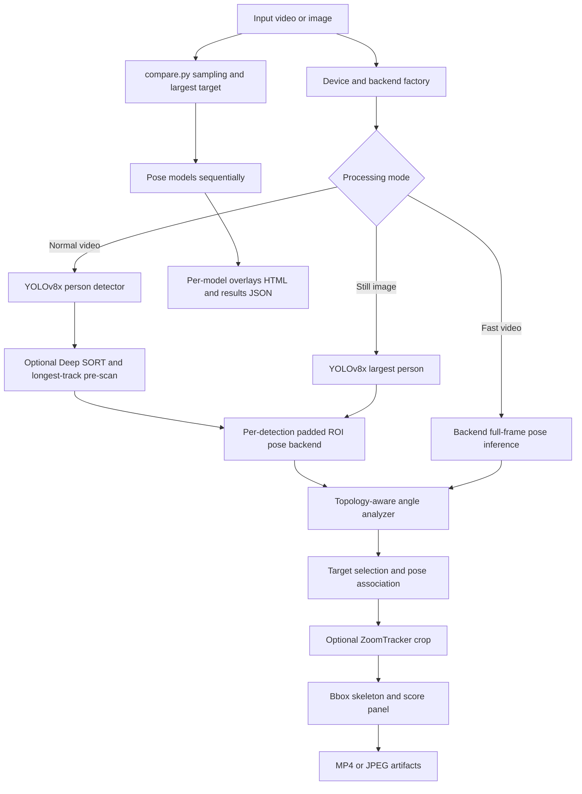

# System overview and architecture

**Status:** Observed as-is at `main@f95d68c`. **Primary code:** `run.py`, `compare.py`, `src/skisense/`.

## 1. Purpose and boundary

SkiSense is an offline Python computer-vision tool for reviewing a skier's posture in an image or video. It detects people, estimates a skeleton, computes selected joint-angle heuristics, renders overlays, and saves media artifacts. It is a **form-visualization and feedback tool**, not an autonomous ski-instruction system, certified biomechanical measurement device, or competition judge.

There is no public HTTP API, database, web service, cloud inference, training pipeline, persistent user-profile store, or automated cross-run aggregation in this repository. Source videos/images and model weights reside locally; model download/authentication and optional external sources require network access during setup.

## 2. Executable entry points

| Entry point | Responsibility | Output |
| --- | --- | --- |
| `python run.py [filename]` | Video orchestration; default `input/video.mp4` | Annotated MP4, input copy and conditional best shot |
| `python run.py [filename] --image` | Analyze one still image; default `input/image.jpg` | Annotated JPEG and input copy |
| `python compare.py filename` | Visually compare selected pose models on sampled frames | HTML index, JPEGs and structured `results.json` |
| `src.skisense.process_video/process_image` | Importable Python call surfaces | Side-effecting file generation, no structured result |

Both `run.py` and `compare.py` import the package; imports eagerly load third-party dependencies through `src/skisense/__init__.py`, `image_processor.py` and `main.py`. The repository is script-oriented and has no packaging/build manifest for distributing a wheel.

## 3. Runtime topology

The graph is conceptual, not a promise that all modes run each stage. In particular, `--fast` ordinarily bypasses per-frame YOLOv8x and Deep SORT, but **`--fast --target-mode longest` with zoom enabled performs a separate YOLO/Deep SORT pre-scan**. See [video-processing.md](video-processing.md).

## 4. Mode matrix

| Aspect | Normal video | Fast video | Still image | Model comparison |
| --- | --- | --- | --- | --- |
| Separate YOLOv8x person detection | Every frame | Only initial longest-track pre-scan when enabled | Once | Each sampled frame |
| Deep SORT | Pre-scan for `longest`, or per-frame for `largest` when zoom enabled | Only longest-track pre-scan (conditional) | No | No |
| Pose inference | Per detected bbox via `estimate` | `estimate_full_frame` | Largest detected bbox via `estimate` | Shared bbox via `estimate` for each selected model |
| Subject choice | Tracked target if zoom enabled; zoom-off defect | Pre-scan bbox match or largest pose bbox | Largest detection | Largest YOLOv8x detection in each sample |
| Zoom / info panel | Optional / yes when analysis exists | Optional / yes when analysis exists | Identity coordinates / yes when analysis exists | Fixed display crop, no skiing score |
| Output | Video + optional best frame | Video + optional best frame | JPEG | HTML, JSON, JPEGs |

Regular processing backends are `yolo26` (default), `yolo11`, and `sam3d`; `rtmw3d` is **comparison-only**. Device and dependency constraints are in [pose-backends-and-data-contracts.md](pose-backends-and-data-contracts.md).

## 5. Component ownership

| Path | Primary responsibility |
| --- | --- |
| `src/skisense/config.py` | Repository-relative paths, `.env` parsing, setting defaults |
| `src/skisense/main.py` | Device selection, YOLOv8x detection, Deep SORT, video lifecycle, target selection and drawing |
| `src/skisense/image_processor.py` | Still-image lifecycle; reuses detection/rendering from `main.py` |
| `src/skisense/backends/base.py` | Abstract `PoseBackend.estimate` interface |
| `src/skisense/backends/__init__.py` | Backend name validation and lazy concrete construction |
| `src/skisense/backends/yolo11_backend.py` | YOLO11/YOLO26 ROI and full-frame pose, flip TTA |
| `src/skisense/backends/sam3d_backend.py` | Gated CUDA SAM 3D Body inference and MHR conversion |
| `src/skisense/pose_topology.py` | Joint index maps, render edges, 2D/3D semantics and flip pairs |
| `src/skisense/pose_analyzer.py` | Angles, category grades, aggregate heuristic and landmark centers |
| `src/skisense/zoom_tracker.py` | Target continuity, crop scale, missing-detection fallback |
| `src/skisense/preprocessing.py` | Optional ROI CLAHE |
| `src/skisense/_logging.py` | Log/warning suppression and file-descriptor stderr redirection |
| `src/skisense/pose_comparison.py` | Sample selection, model loop, comparison JPEG/HTML/JSON |
| `src/skisense/compare_rtmw3d.py` | Optional RTMW3D projected 2D adapter; no score |
| `tests/` | Backend-selection and comparison unit tests; docs link check |
| `.github/workflows/static-checks.yml` | PR/main Python compilation and Markdown relative-link checks |

`src/skisense/__init__.py` re-exports `main` (alias for `process_video`), `process_video`, `process_image`, `analyze_ski_pose`, and `COLORS`; its `__version__` is `1.0.0` and is **not** a versioned scoring contract. `.claude/CLAUDE.md` imports the root [AGENTS.md](../../AGENTS.md).

## 6. Data and coordinate boundaries

1. Video/image frames are OpenCV BGR arrays; dimensions are `(height, width, channels)`.
2. Person detector and Deep SORT use original-frame pixel bboxes `(x, y, width, height)`; tracker output `(left, top, right, bottom)` is converted and clipped.
3. Pose backends emit a **padded ROI bbox**, original detection bbox, landmark objects with normalized ROI `x/y` and visibility, plus a `PoseTopology`. A SAM 3D Body landmark additionally carries inferred camera-frame `x3d/y3d/z3d`.
4. The analyzer calculates image-plane shoulder tilt for every backend, 2D knee/hip for COCO-17, and inferred 3D knee/hip/ankle for MHR.
5. Render helpers map ROI coordinates to original-frame coordinates and then to the possibly cropped frame, via `transform_point_to_zoom`.
6. The comparison exporter serializes **absolute image pixels**, not the normalized ROI coordinates, and may include unaligned model-specific 3D arrays.

Do not interpret a topology name, landmark visibility, projected angle, camera-space angle, or heuristic score as interchangeable without an explicit conversion and validation protocol.

## 7. State and lifecycle

A normal or fast video run creates one selected backend, and optionally YOLOv8x/Deep SORT and a `ZoomTracker`; state is held in memory until completion or interruption. `ZoomTracker` maintains the last valid target for a limited number of frames. `latest_pose_analysis` is replaced on each frame (including `None` when no valid pose); the best-shot candidate retains the highest observed score and a copied rendered frame. No state survives across runs except generated files and cached weights.

`compare.py` loads one comparison backend at a time across the selected frames, records failure per model/frame, then closes it. Clean shutdown paths are not exception-safe in all modes; see [output-and-failure-semantics.md](output-and-failure-semantics.md).

## 8. Confidence, compatibility and non-goals

The codebase contains explicit limitations and unverified claims, collected in the [verification matrix](verification-matrix.md). Notably, `--high` is a no-op; zoom-off normal-video target drawing differs from intended behavior; SAM3D full-frame lacks a detector; MP4 write success is unchecked; scoring thresholds are unvalidated. Throughput, relative model quality, real-time operation and cross-platform SAM3D compatibility have **not** been established by this source review.
